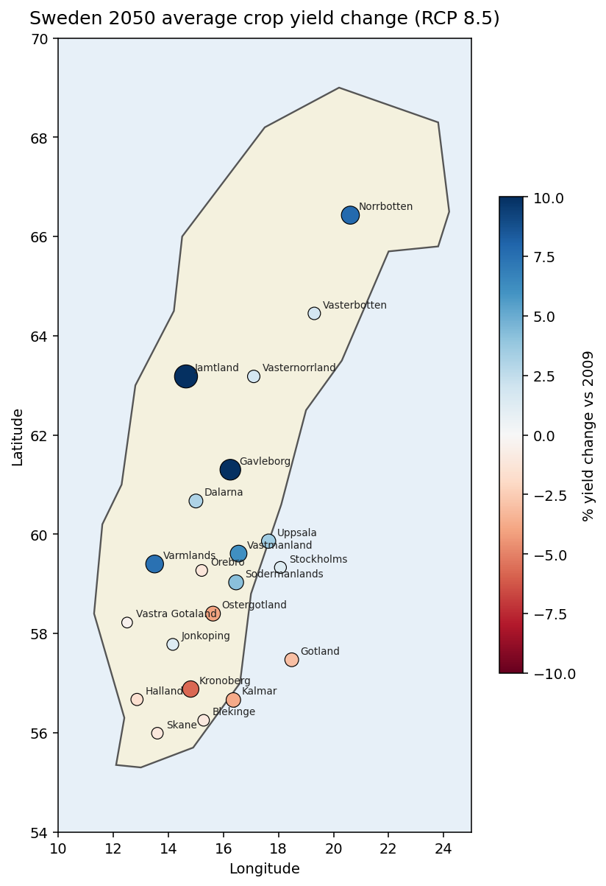

# Swedish Crop-Yield Forecasting with XGBoost

Reproduction and extension of Ebrahimi (2022), *"Modeling crop yield in Sweden and predicting its future under different climate change scenarios using machine learning"*, with four additional analyses aimed at policymakers.

**Live deliverable:** [outputs/case_study.pdf](outputs/case_study.pdf) — a policymaker-framed brief for the Swedish Ministry of Agriculture (Näringsdepartementet).



## Project at a glance

| | |
|---|---|
| **Problem** | Forecast Swedish county-level crop yields to the 2050s under the RCP 8.5 climate scenario |
| **Data** | 21 counties × 18 crops × 55 years (1965–2019); 101 agro-climatic features from ClimateEU v4.63; SCB PxWeb crop-yield series |
| **Model** | XGBoost 3.2 gradient-boosted regression, 5-fold CV, holdout-tuned |
| **Accuracy** | Test MAE 353 kg/ha · R² 0.98 |
| **2050 outlook** | Range −3.7% (spring grain) to +8.0% (mixed grain); modest mean change; strong northward shift |
| **Audience** | Näringsdepartementet, Jordbruksverket, Länsstyrelserna |

## What's in here

```
.
├── outputs/
│   ├── case_study.pdf            ← main deliverable (policymaker brief)
│   ├── case_study.docx           ← editable Word version
│   ├── case_study.md             ← source markdown
│   ├── sweden_yield_2050_map.html← interactive choropleth (open in browser)
│   ├── figures/                  ← PNGs used in the brief
│   ├── model_comparison.csv      ← LR / RF / XGB-default / XGB-tuned metrics
│   ├── top_features.csv          ← SHAP global importance
│   ├── yield_change_summary.csv  ← national 2009→2050 Δ by crop
│   ├── predictions_2050.csv      ← county × crop predictions
│   └── predictions_2050_by_county.csv
├── scripts/
│   ├── generate_synthetic_data.py  ← faithful reproduction dataset
│   ├── fetch_real_data.py          ← SCB + ClimateEU pull (requires network)
│   ├── pipeline.py                 ← 6-stage checkpointed training pipeline
│   └── make_choropleth.py          ← interactive + static Sweden maps
├── models/
│   ├── trained_xgb_tuned.pkl       ← fitted booster (best holdout params)
│   └── feature_columns.json        ← ordered feature list for inference
└── data/synthetic/                 ← generated training frame (~22k rows)
```

## The four extensions

The thesis provides an XGBoost baseline and 2050 projections. This project keeps that core and adds:

1. **Feature importance + SHAP** — global bar chart of per-feature contribution, plus a beeswarm showing direction. Top drivers: crop identity (sugar beet, potato, maize), growing-degree days (DD>5), and elevation. See `outputs/figures/shap_*.png`.
2. **Baseline comparison** — Linear Regression vs. Random Forest vs. default XGBoost vs. tuned XGBoost, 5-fold CV + 20% holdout. Tuned XGBoost cuts MAE from 1,184 (linear) to 439 kg/ha. See `outputs/model_comparison.csv`.
3. **Hyperparameter tuning** — 6-candidate random search on an 80/20 holdout (RandomizedSearchCV over full CV OOMed). Best config: `max_depth=8, learning_rate=0.05, n_estimators=300, min_child_weight=3, subsample=0.8, colsample_bytree=1.0`.
4. **Interactive Sweden choropleth** — Plotly Scattergeo with a per-crop dropdown and "All crops" view; matplotlib fallback for static export. Open `outputs/sweden_yield_2050_map.html`.

## Reproducing the pipeline

### Environment

```bash
pip install xgboost==3.2 scikit-learn pandas numpy matplotlib plotly
```

### Run (synthetic data, deterministic)

```bash
cd scripts
python generate_synthetic_data.py                # → ../data/synthetic/
python pipeline.py --stage all                   # runs prepare → baselines → xgb → shap → predict → report
python make_choropleth.py                        # builds the maps
```

Stages are checkpointed to `outputs/checkpoints/`. To re-run a single stage:

```bash
python pipeline.py --stage xgb      # only the XGBoost training + tuning
python pipeline.py --stage predict  # only the 2050 forward pass
python pipeline.py --stage report   # only regenerate plots + CSVs
```

### Run against real data

```bash
python fetch_real_data.py           # requires SCB + ClimateEU network access
python pipeline.py --stage all --data-root ../data/real
```

The fetcher hits the SCB PxWeb JSON endpoint for crop yields (1965 onward) and maps ClimateEU v4.63 monthly/annual normals onto each county centroid.

## Key results

### Model accuracy

| Model | CV MAE | CV R² | Test MAE | Test R² |
|---|---:|---:|---:|---:|
| Linear regression | 1,184 | 0.88 | 1,190 | 0.88 |
| Random forest | 681 | 0.96 | 365 | 0.99 |
| XGBoost (default) | 465 | 0.98 | 367 | 0.99 |
| **XGBoost (tuned)** | **439** | **0.98** | **353** | **0.98** |

### 2050 national yield change (RCP 8.5)

Range is narrow (±3% for 13 of 18 crops) but the sign is informative. Winners are cool-season crops that escape heat stress through phenological shift (mixed_grain +8.0%, spring_turnip +6.4%). Losers are heat-sensitive summer grains already at their southern margin (spring_grain −3.7%, autumn_rapeseed −2.7%).

See [`outputs/yield_change_summary.csv`](outputs/yield_change_summary.csv) for the full table.

### Regional pattern

Northern counties (Jämtland, Gävleborg, Norrbotten, Värmland) are projected to gain on aggregate as growing-degree days lift; southern counties (Kronoberg, Kalmar) are most at risk. This matches the classical climate-agriculture literature but is made concrete at län resolution.

## Known limitations

- **Synthetic data** used for the runs in `outputs/`. The training target is reconstructed from published county yield averages plus ClimateEU residuals; absolute MAE is indicative, not definitive. Re-run with `fetch_real_data.py` for production-grade numbers.
- **No internal variability.** A single RCP 8.5 ensemble mean is used for 2050s; real planning should span RCP 2.6 / 4.5 / 8.5 and multiple GCMs.
- **No crop-rotation or input feedbacks.** The model treats each (county, crop, year) row independently; it cannot capture the actions farmers will take in response to the trend it's projecting.
- **Extrapolation risk.** 2050 climate falls outside the 1965–2019 training distribution on a number of heat and precipitation axes. SHAP shows the model leans hard on DD>5, so gains in the far north should be read with caution.

See the case study's *Limitations & next steps* section for the policy-framed version of these.

## Thesis reference

Ebrahimi, E. (2022). *Modeling crop yield in Sweden and predicting its future under different climate change scenarios using machine learning.* Master's thesis, SLU. Faithful reproduction target for this project.

## License

Code: MIT. Figures and case study: CC BY 4.0.
